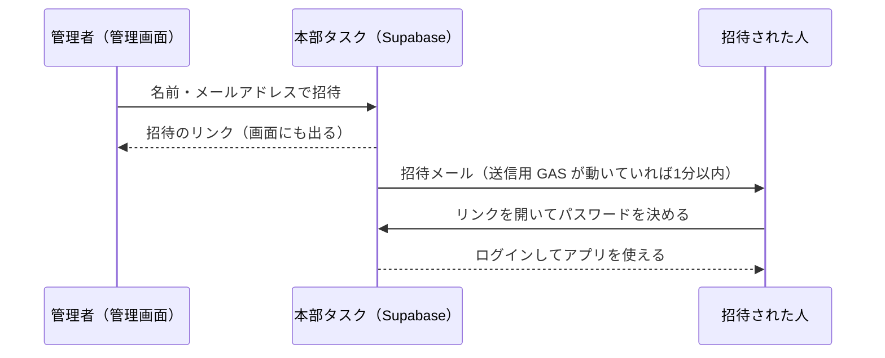

# アカウントと管理画面 要件定義書（v1.0）

作成日: 2026-10-14 ／ 状態: **作成済み（本番に反映済み）**

本部タスクのアカウントは**招待制**。管理者が管理画面から招待した人だけが使える。自分でアカウントを作る入り口はない。

---

## 1. しくみ

## 2. アカウントの種類と状態

| 項目 | 内容 |
|---|---|
| 個人のアカウント | メンバー1人と結びつく。登録・変更の記録には本人の名前が自動で残る（ほかの人になりすませない） |
| 共有のアカウント | 何人かで使う（最初の本部の共有アカウント）。端末ごとに「操作する人」を選ぶ |
| 管理者 | 管理画面に入れる。メンバーの追加・変更、メール通知の設定も管理者だけ |
| 全権限 | 本部の管理用アカウント（「ネコロボマン本部」）。管理者のすべての操作ができ、これから増える権限（責任者など）もすべて持つ。ほかの管理者は、停止する・管理者から外す・パスワード再設定のリンクを作る ことができない（乗っ取りを防ぐ）。全権限は管理画面からは付け外しできず、データベースで直接決める |
| 状態 | 招待中 → 使用中（本人がパスワードを決めた）／ 停止中（すぐ使えなくなる。記録は残る）／ 取り消し（招待をやめた。記録は残る） |

## 3. 管理画面（admin.html）でできること

| 操作 | 内容 |
|---|---|
| 招待する | 名前とメールアドレス（管理者にするかも選べる）。リンクは7日間・1回だけ |
| 招待を送り直す | 新しいリンクを作る（前のリンクは使えなくなる） |
| 招待を取り消す | まだ使い始めていない招待だけ。メンバーの名前は残る |
| パスワード再設定 | 使用中の人に、パスワードを決め直すリンクを作る（24時間・1回だけ） |
| 停止・再開 | 停止するとすぐに使えなくなる。再開で戻る |
| 管理者にする・外す | 自分自身は外せない。管理者が1人もいなくなる操作はできない。全権限のアカウントは外せない |
| アカウントのないメンバー | 担当者として選ぶだけの名前を追加・在籍の切り替え・あとから招待 |

## 4. 守り（データベース側で守る）

- 画面からの操作は、すべて入り口（`api_call`）を通る。使用中のアカウントでなければ何もできない
- 管理者だけの操作（招待・停止・メンバー・メール通知の設定）は、管理者でなければデータベースが断る
- 管理画面の操作は、**パスワードでログインしてから8時間以内**だけ。管理画面はアプリとは別にログインが要り、タブを閉じるか30分操作がないとログアウトする
- 招待・再設定のリンクの合言葉は、データベースにはハッシュ（元に戻せない形）で残す。メールで送るまでのあいだだけ、送る係が読める
- **招待されていないメールアドレスでは、ログインそのものを作れない**（Supabase の「新規登録」から作ろうとしても断る）
- 以前の「はじめての方（共有アカウントのパスワードを決める）」の入り口は使えなくした

## 5. あとで決めること

- 責任者と職員の役割（[roles-requirements.md](roles-requirements.md)）。8章の No.3「責任者の操作の守り」は、一人ずつのログイン（招待制）で実現できるようになった
- 2段階認証（スマホの認証アプリ）を管理者に付けるか
