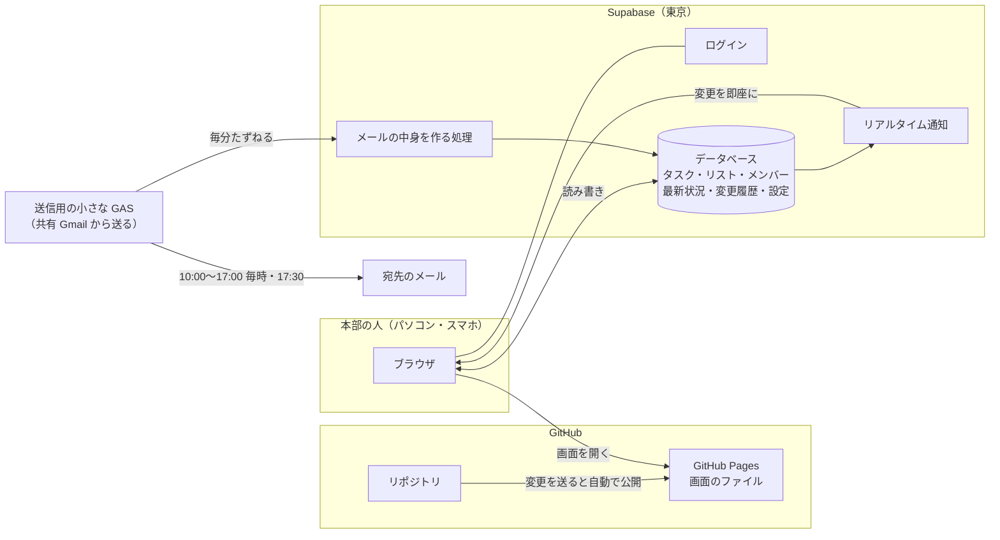

# 本部タスク 構成の設計（スプレッドシートのままでよいか・どこに置くか）

作成日: 2026-10-13 ／ 状態: **提案（決めてもらう前）**

## 結論（おすすめ）

**画面は GitHub（GitHub Pages）、データは Supabase に置く。**

- タスクが増えても速さが落ちない（データベースなので、何万件でも一瞬で探せる）
- 他の人の変更が**その瞬間に**全員の画面に出る（今の「4秒ごとに確認」より速く、無駄もない）
- **作る・直す・公開するを、このチャットから全部できる**（Google の画面で貼り付け・公開をする手間がなくなる）
- 将来の社内管理システム（nekoroboapp）も Supabase の予定なので、あとでつなぎやすい
- 費用は最初は0円（Supabase 無料プラン・GitHub Pages 無料）

メールの送信だけは、当面いまの共有 Gmail を使う（小さな送信用 GAS を1回だけ置く）。会社のドメインでメール送信の準備ができたら、Supabase から直接送る形に切り替える。

---

## 1. スプレッドシートのままで大丈夫か

### 量の見込み

| 項目 | 見込み |
|---|---|
| 本部の人数 | 10〜30人 |
| タスクの数 | 20人 × 1日5件 × 年245日 ≒ **年2.5万件**（サブタスク・最新状況・変更履歴は別に増える） |

### スプレッドシート（今の GAS 版）の限界

| 点 | 内容 |
|---|---|
| 速さ | 1つの操作ごとに表を丸ごと読む作り。**5千件で1〜2秒、2万件で3〜5秒**かかるようになる。書き込みは1件ずつ順番なので、何人かが同時に押すと待ちが出る |
| 上限 | 1ファイル1,000万マスまで。今の作りだと約14万件で頭打ち |
| 最新の反映 | 画面が数秒ごとに確認しに行く方式。人数が増えるほど Google 側の実行回数が増える |
| 公開の手間 | プログラムを直すたびに、Google の画面で貼り付け→デプロイが必要（このチャットからはできない） |
| 壊れやすさ | シートを人が直接いじると、ずれることがある |

→ 完了したタスクを別のシートに移す（アーカイブ）を足せば1〜2年は持つが、**「増えたときに管理できるか」という心配には根本的には応えられない。**

### Supabase（データベース）にすると

| 点 | 内容 |
|---|---|
| 速さ | 何万件あっても1操作 0.1秒前後。探す・数えるのが得意 |
| 上限 | 無料プランで 500MB ≒ 20万件以上（10年分くらい） |
| 最新の反映 | 変更があった瞬間にデータベースから全員の画面へ知らせが届く（リアルタイム） |
| 公開の手間 | このチャットから直接作れる・直せる |
| 守り | ログインした人しかデータを読み書きできないように、データベース側で止める |

---

## 2. 置き場所の比較

| 案 | 画面 | データ | よい点 | 気になる点 |
|---|---|---|---|---|
| A. 今のまま | GAS | スプレッドシート | もうできている | 上の限界。直すたびに Google の画面で手作業 |
| B. 画面だけ GAS | GAS | Supabase | Google ログインで守れる | 直すたびの手作業は残る |
| **C. おすすめ** | **GitHub Pages** | **Supabase** | 手作業なしで作る・直す・公開ができる。速い。費用0円から | GitHub の設定で1回だけクリックが必要。メール送信は工夫が要る（4章） |
| D. 本格版 | Vercel（Next.js） | Supabase | 社内管理システムと同じ作り | 準備が多く、今日中は無理。社内管理システムができたら、そちらに引っ越す |

### 「GitHub をサーバーにする」について

- GitHub Pages は、GitHub に置いた画面のファイルをそのままインターネットに公開する仕組み（無料）。**プログラムを動かすサーバーやデータベースにはならない**ので、データと処理は Supabase が受け持つ
- GitHub に変更を送ると、数分で公開中の画面に自動で反映される
- このリポジトリは公開設定なので、画面のプログラムは誰でも見られる（今と同じ）。**データは Supabase のログインで守る**ので、ログインできない人には見えない

---

## 3. おすすめ構成（C）の全体図

### データベースの表

| 表 | 中身 | 守り |
|---|---|---|
| members | メンバー（名前・メール・在籍） | ログインした人だけ |
| lists | リスト | 同上 |
| tasks | タスク（何を・誰が・いつまでに・どのように・ステータス・スター・繰り返し・最新状況 など） | 同上。**親タスクは「担当者」と「期限」が空だと保存できない**ようにデータベースで止める |
| task_notes | 最新状況の履歴 | 同上 |
| task_history | 変更の記録（誰が・いつ・何を何に） | 同上。データベースが自動で書く（画面からは消せない） |
| settings | メール通知などの設定 | 同上 |
| mail_log | メールの送信履歴 | 同上 |

- 変更の記録・版の番号・完了日時・繰り返しの次の回は、**データベース側で自動で作る**（画面の作りに頼らない）
- よく使う探し方（担当者別・期限順・未完了だけ）には索引を付けて、件数が増えても速くする
- 完了から90日たったタスクは最初の読み込みに含めない（検索すれば出る）

### 同時に使うときのしくみ

| 今（GAS 版） | Supabase 版 |
|---|---|
| 4秒ごとに確認しに行く | 変更があった瞬間に届く（つながらないときだけ1分ごとに確認） |
| 書き込みは1件ずつ順番（待ちが出る） | データベースが行ごとに守るので、同時に押しても待たない |
| 変えた項目だけを送り、サーバーで重ねる | 同じ（変えた項目だけを更新）。ほかの人の変更と重なったら知らせる |
| 端末ごとに「操作する人」を選ぶ | 同じ |

### ログイン

- まずは**本部の共有アカウント1つ**（メールアドレス＋パスワード）でログインする。今と同じく、端末ごとに「操作する人」を選ぶ
- 一度ログインすれば、その端末ではログインしたままになる
- 将来は、一人ずつのアカウントに切り替えられる（「自分の担当」が自動になり、なりすましもできなくなる）

---

## 4. メールの送り方

| 方法 | 手間 | よい点 | 気になる点 |
|---|---|---|---|
| **M1. 送信用の小さな GAS（おすすめ・今日）** | 共有アカウントで1ファイルを貼り付け、1回「許可」する（最初だけ） | 今と同じ共有 Gmail から送れる。時刻どおり（毎分確認） | Gmail の無料アカウントは1日100通まで（1日9回なら宛先11件まで） |
| M2. メール配信サービス（Resend）＋会社のドメイン | 会社ドメインの DNS に設定を足す（ドメインの管理者） | 送れる数に余裕がある。社内管理システムと同じ方式 | DNS の設定ができる人が必要 |
| M3. Gmail の「アプリ パスワード」で Supabase から直接送る | 共有アカウントで2段階認証をオンにし、アプリ パスワードを作る | GAS が要らない | Google の設定が必要。送れない場合がある（送信の仕組みの制限） |

- M1 の GAS は「メールを送るだけ」の小さなもので、**画面を直しても貼り替える必要はない**（中身は Supabase 側で作るため）
- 送る時刻・宛先・内容は今と同じ（平日 10:00〜17:00 の毎時ちょうど＋17:30 に今日のまとめ、祝日・年末年始は送らない）。設定は画面から変えられる

---

## 5. 費用

| もの | 費用 | 補足 |
|---|---|---|
| Supabase | **0円**（無料プラン） | 無料プランは、1週間まったく使わないと一時停止する（毎日使えば止まらない）。毎日の自動バックアップが要るなら Pro（月25ドル≒4,000円）へ |
| GitHub Pages | 0円 | リポジトリが公開設定のため。非公開にしたい場合は GitHub の有料プラン（月4ドル）か、別の公開サービスに |
| メール | 0円 | M1（Gmail）の場合 |

Supabase の組織は無料プランで、動いているプロジェクトは今1つ。無料プランは2つまで動かせるので、**本部タスク用に新しく1つ作れる**。

---

## 6. 今日の作業の段取り

| 順 | 作業 | だれが | 目安 |
|---|---|---|---|
| 1 | この設計で進めてよいか決める（7章） | あなた | − |
| 2 | Supabase に本部タスク用のプロジェクトを作り、表・守り・自動の記録を作る | Claude | 1時間 |
| 3 | 画面を Supabase につなぎ替える（見た目と操作は今の GAS 版のまま） | Claude | 1〜2時間 |
| 4 | メールの中身を作る処理を Supabase に置く | Claude | 1時間 |
| 5 | GitHub Pages で公開する設定を入れる | Claude | 15分 |
| 6 | GitHub の設定で「Pages」をオンにする（1回クリック）／変更を本番のブランチに取り込む | あなた（または許可をもらって Claude） | 5分 |
| 7 | 共有アカウントでログインを作る（最初の1回だけ確認メールが届く） | あなた | 5分 |
| 8 | 送信用の小さな GAS を貼って許可する（M1 の場合） | あなた（または別の PC の Claude） | 10分 |
| 9 | 2人同時に操作するテスト・メールのテスト | Claude | 30分 |

- 今の GAS 版（スプレッドシート）はそのまま残しておく。Supabase 版で問題がないことを確かめてから切り替える
- 今の GAS 版にもう入れたタスクがあれば、Supabase 版に移せる

## 7. 決めてほしいこと

| No | 決めること | おすすめ |
|---|---|---|
| 1 | 構成 | **C（GitHub Pages ＋ Supabase）** |
| 2 | Supabase に本部タスク用の新しいプロジェクト（無料）を作ってよいか | **作る**（既存のプロジェクトには触らない） |
| 3 | メールの送り方 | **M1（送信用の小さな GAS）**。会社ドメインの準備ができたら M2 に切り替え |
| 4 | 画面を公開リポジトリの GitHub Pages に置いてよいか（データはログインで守る） | **置く** |
