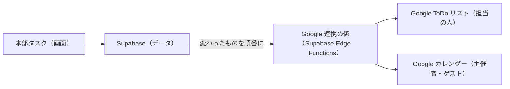

# カレンダー 要件定義書（v1.0）

作成日: 2026-10-14 ／ 状態: **作成済み（本番に反映済み）**

お手本は **Google カレンダー**。操作・画面の作りを同じにした。Google Meet（ビデオ会議）は作らない。
画面上の「タスク ／ カレンダー」で切り替える。

---

## 1. できること

### 1.1 表示

| 機能 | 内容 |
|---|---|
| 表示の切り替え | 日・週・月・年・スケジュール（一覧）・4日。右上の選びボックス、またはキー（d・w・m・y・a・x） |
| 移動 | 「今日」・前へ・次へ（キー t・j/n・k/p）。左の小さなカレンダーで日を選ぶ |
| 今の時刻 | 週・日の表示に赤い線 |
| 祝日 | 日本の祝日を表示（左の「日本の祝日」で出す・隠すを切り替え） |
| タスク | 本部タスクの「いつやる」（なければ期限）の日に表示。時刻があればその時刻に。チェックで完了にできる |
| カレンダーの表示・非表示 | 左の一覧でチェック。「このカレンダーだけ表示」もできる |
| 検索 | 虫めがね（キー /）でタイトル・場所・説明から探す |
| 設定 | 週の始まり（日・月・土）・予定の長さの初期値・週末を表示・辞退した予定を表示・週番号・ブラウザの通知 |

### 1.2 予定を作る・変える

| 機能 | 内容 |
|---|---|
| すばやく作る | 空いている時間をクリック（ドラッグで長さを決める）→ タイトルを入れて保存。「タスク」タブに切り替えれば、その日にやるタスクとして登録 |
| 詳しく作る | 左上の「作成」、または「その他のオプション」→ 編集画面 |
| ドラッグ | 予定をつかんで別の日時へ移動、下の端を引いて長さを変える（月の表示でも日をまたいで移動） |
| 終日・何日もまたぐ予定 | 「終日」にチェック。上の段に横長で出る |
| 繰り返し | タスクと同じ設定（毎日・毎週○曜日・毎月第○○曜日・毎年・平日・カスタム／終了日・回数） |
| 繰り返しの一部を変える・消す | 「この予定」「これ以降のすべての予定」「すべての予定」から選ぶ（Google と同じ） |
| 場所・説明 | 入れられる |
| 通知 | 「○分前・○時間前・○日前・○週間前」を5つまで。画面のお知らせ（このアプリを開いているとき）とブラウザの通知 |
| 色 | 予定ごとに 11 色（Google と同じ色）。カレンダーの色も変えられる |
| 予定あり／空き・公開設定 | 「予定あり／空き」と「デフォルト・公開・非公開」 |
| 複製・削除 | 予定のポップアップのメニューから。消したら「元に戻す」、30日間は「ごみ箱」から戻せる |

### 1.3 カレンダーとゲスト

| 機能 | 内容 |
|---|---|
| カレンダー | メンバーごとに「自分のカレンダー」が自動でできる。ほかに「共有のカレンダー」（例: 本部行事）を作れる |
| ほかの人のカレンダー | 左の「ほかのメンバー」でチェックすると重ねて見られる |
| ゲスト | 本部のメンバーを招待する。招待された人のカレンダーにも出る（返事するまでは枠だけの表示） |
| 出欠 | 「はい・いいえ・未定」。繰り返しの予定は「この予定だけ」か「すべて」を選べる。主催者の画面に返事が届く |
| ゲストの権限 | 予定を変える・ほかの人を招待する・ゲストの一覧を見る を選べる |
| 時間を探す | 編集画面の「時間を探す」で、ゲスト全員の予定を並べて空き時間を見る |

### 1.4 作らないもの

| もの | 理由・代わり |
|---|---|
| Google Meet（ビデオ会議） | 作れないため。場所や説明に URL を貼る |
| メールでの招待・メールの通知 | Google 連携（2章）で、Google カレンダーから届くようにする |
| 予約スケジュール・不在・作業場所・タイムゾーン切り替え | 本部の使い方では当面いらない。必要になったら足す |
| 社外の人の招待 | 本部メンバーだけ。Google 連携のあとに検討 |

---

## 2. Google との連携（2026-10-14 作成済み。使い始めは README の「5. Google 連携」）

**ねらい**: このアプリで入れたタスク・予定が、担当の人の **Google ToDo リスト** と **Google カレンダー** に自動で出る。

### 2.1 しくみ

1. メンバーが一人ずつ、設定 →「Google と連携」で自分の Google アカウントを1回だけつなぐ（Google の「許可」画面が出る）
2. タスクや予定が変わるたびに「送る順番待ちの表」に積み、連携の係が1件ずつ Google に送る（失敗したら時間をおいてやり直す）
3. どの Google の予定・タスクと対応しているかを表に残し、変更・削除も同じものに反映する
4. 鍵（Google からもらう合言葉）はデータベースの、画面からは読めない場所にだけ置く

### 2.2 反映のされ方

| こちらで | Google ToDo リスト | Google カレンダー |
|---|---|---|
| タスクを登録・変更 | 担当の人の「本部タスク」リストに、タイトル・詳細・期限（日付）・完了を反映 | − |
| 予定を登録・変更 | − | 主催者のカレンダーに、タイトル・日時・終日・繰り返し・場所・説明・通知・色・予定あり／空き を反映 |
| ゲストを招待 | − | ゲストのカレンダーにも出る |
| 削除・完了 | 完了にする・消す | 消す |

- Google ToDo リストは、時刻と繰り返しの決まりを外から入れられない（Google の制限）。期限の日付だけ入れ、繰り返しは「次の回ができたら、その回を新しく入れる」形にする
- 最初は **こちら → Google の一方向**。Google 側で直接変えたものをこちらに取り込むのは、そのあとで決める

### 2.3 最初に1回だけ必要な Google の設定（本部の共有アカウントで）

1. Google Cloud（https://console.cloud.google.com）でプロジェクトを1つ作る
2. 「Google Calendar API」と「Google Tasks API」をオンにする
3. 「OAuth 同意画面」（今の表示は「Google Auth Platform」）を作る（種類は「外部」、アプリ名は「本部タスク」）→「本番環境に公開」にする
   - 公開するには「ブランディング」に、アプリ名・サポートメール・ホームページ（https://app.nekorobogroup.com/honbu-task/ ）・プライバシーポリシー（https://app.nekorobogroup.com/honbu-task/privacy.html ）・承認済みドメイン（nekorobogroup.com）が要る。ロゴは入れない（入れると Google の審査が要る）
   - 「テスト中」のままだと、7日ごとにつなぎ直しが必要になるため
   - Google の審査はしないので、許可の画面で「確認されていないアプリ」と出る（「詳細」→「移動」で進める。本部の人数なら問題なし）
4. 「認証情報」→「OAuth クライアント ID」（種類はウェブアプリ）を作る。戻り先の URL は、作る段階でこちらから伝える
5. できた「クライアント ID」と「クライアント シークレット」は、**チャットに貼らず**、管理画面の「Google 連携」に貼って保存する（画面からは読めない表に入る）。Supabase の管理画面（Edge Functions → Secrets）に `GOOGLE_CLIENT_ID`・`GOOGLE_CLIENT_SECRET` として入れてもよい（そちらが優先）

### 2.4 作ったもの

| もの | 中身 |
|---|---|
| 表 `google_links` | 人ごとの連携（Google のアドレス・トークン・何を反映するか・どこまで反映したか）。画面からは読めない |
| 表 `google_map` | こちらのタスク・予定と Google 側の ID の対応（人ごと） |
| 表 `google_oauth_states` | Google の許可画面に送り出すときの合言葉（ハッシュ。15分・1回だけ） |
| Edge Function `google` | Google の許可・戻り先・トークンの保存・反映（`plan.ts` が「何をどう送るか」を決める） |
| pg_cron `honbu-google-sync` | 1分ごとに、変わったものがあれば反映する |
| 画面 | アプリの歯車 →「Google 連携」（一人ずつ）／ 管理画面の「Google 連携」（初期設定とみんなの状態） |

- 予定の Google 側の ID は「人＋予定」から決まった値にしている（やり直しても二重にならない）
- 30日より前に終わった1回だけの予定、すでに完了したタスクは、新しくは出さない
- 連携は個人のアカウントだけ（共有のアカウントでは、誰の Google か決められないため）

---

## 3. データ

| 表 | 中身 |
|---|---|
| calendars | カレンダー（名前・色・説明・持ち主のメンバー。持ち主なし＝共有） |
| events | 予定（日時・終日・繰り返し・場所・説明・色・予定あり／空き・公開設定・通知・ゲストと出欠・ゲストの権限）。繰り返しの1回だけ変えたものは、元の予定と元の日時を持つ別の行 |

- 読み書きはタスクと同じく `api_*` 関数だけ（直接は書けない）。行レベルセキュリティあり
- 変更はリアルタイムで全員の画面に出る
- 予定は 400 日より前のものは最初に読み込まず、その期間を開いたときに取りに行く
