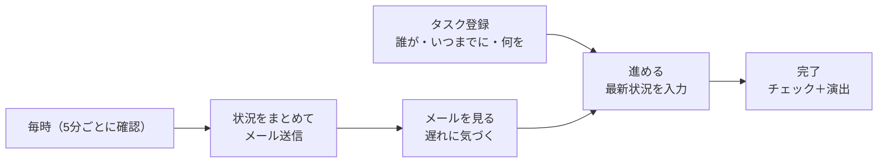

# 本部タスクリスト 要件定義書（v0.2）

作成日: 2026-10-12 ／ 更新日: 2026-10-13 ／ 状態: **Supabase 版を作成済み（本部で確認中）**

> 2026-10-13 追記: タスクが増えても大丈夫なように、データの置き場所をスプレッドシートから Supabase（データベース）に変えた。画面は GitHub Pages。詳しくは [構成の設計](architecture.md)。下の「GAS」「スプレッドシート」の記述は旧版のもの

> v0.1 からの変更点（ユーザーの回答を反映）
> - お手本のアプリは **Google ToDo リスト**
> - **Google Apps Script（GAS）＋ Google スプレッドシート**で作る。本部の共有 Google アカウントで動かす
> - **同じアカウントを何人かで同時に使う**ので、ほかの人の変更をすぐ画面に反映するしくみを入れる（指定申請アプリと同じ考え方）

---

## 1. 目的

1. 本部の従業員のタスクを「**誰が・いつまでに・何を**」の形で必ず登録し、進み具合をみんなで見られるようにする
2. **1時間に1回**、本部のタスクの状況をメールで届け、「1時間に1回タスクを見る」流れをつくる
3. いつも使っている Google ToDo リストと**同じ操作感**にして、新しく覚えることを増やさない

## 2. 前提

| 項目 | 内容 |
|---|---|
| お手本のアプリ | Google ToDo リスト（ブラウザの全画面版） |
| 動かす場所 | Google Apps Script のウェブアプリ。データは Google スプレッドシート |
| アカウント | 本部の共有 Google アカウント（1つ）。**何人かが同時に、別々の端末で使う** |
| 使う人 | 本部の従業員だけ |
| 使う端末 | パソコン（Chrome・Edge）とスマホ（iPhone・Android のブラウザ） |
| 言語・時間 | 日本語のみ／日本時間 |

## 3. 全体像

| 独自機能 | ひとことで | 章 |
|---|---|---|
| 期限設定 | 「誰が・いつまでに・何を」を入れないと登録できない | 5章 |
| 進捗管理 | ステータスと「最新状況」の入力、本部全体の進捗ボード | 6章 |
| メール通知 | 毎時、設定したアドレスに本部のタスク状況を送る | 7章 |
| 同時に使うための反映 | ほかの人の変更が数秒で画面に出る。同時に変えても消えない | 8章 |

---

## 4. お手本（Google ToDo リスト）から引き継ぐ機能

- 機能・画面の並び・操作の流れは、お手本と同じにする
- Google のロゴ・名前・画像は使わない。アイコンは公開されている Material アイコン（Apache 2.0）を使う

### 4.1 画面の構成

| 左: メニュー | 中央 | 右: タスクの詳細（開いたときだけ） |
|---|---|---|
| 「作成」ボタン すべてのタスク・スター付き 自分の担当・進捗ボード（独自） リスト（チェックで表示を切り替え） 新しいリストを作成 ごみ箱 | 「すべてのタスク」では、リストを横に並べて表示 リストを選ぶと、そのリストだけ大きく表示 | タイトル・詳細 誰が・いつまでに（必須） ステータス・サブタスク 最新状況・変更の記録 |

- スマホでは、メニューは左から出す。リストは横にめくる。詳細は全画面で開く

### 4.2 リスト

| 機能 | 内容 |
|---|---|
| 新しいリストを作成 | 名前を入れて作る |
| リスト名を変更・リストを削除 | 削除は確認を出す。最後の1つは消せない。中のタスクはごみ箱へ |
| 表示の切り替え | 左のチェックで「すべてのタスク」に出すリストを選ぶ（端末ごと） |
| リストの並べ替え | 左のメニューでドラッグ |
| タスクの並べ替え | 自分の並べ替え順・日付・スター付き（最近）・タイトル・担当者（独自） |
| 完了したタスクをすべて削除 | 確認を出してからごみ箱へ |
| リストを印刷 | 未完了のタスクを表にして印刷 |

### 4.3 タスク

| 機能 | 内容 |
|---|---|
| 追加 | 「タスクを追加」でその場に入力欄。Enter で登録して、続けて次を入力できる。左上の「作成」からも登録できる |
| 完了 | 丸いチェック。完了は「完了（○件）」にたたんで表示。押すと未完了に戻る |
| 元に戻す | 完了・削除の直後に「元に戻す」が出る |
| スター | ☆で付け外し。「スター付き」に集まる |
| 詳細 | 自由に書けるメモ（＝「どのように」） |
| 日付・時刻 | 今日・明日・来週の月曜・日付を選ぶ、時刻（任意） |
| 繰り返し | 毎日・平日・毎週・毎月・毎年・カスタム（○日／週／か月／年ごと、曜日指定）。完了すると次の回ができる |
| サブタスク | タスクの中の小さなやること。一覧でも親の下に表示 |
| 別のリストに移動 | メニューかドラッグで |
| ドラッグで並べ替え | 「自分の並べ替え順」のとき |
| 削除 | ごみ箱へ（30日間戻せる。お手本と違い、本部の管理のため残す） |
| 検索 | タスク名・詳細・最新状況・担当者から（お手本にはないが、便利なので追加） |

### 4.4 演出

| 演出 | 内容 |
|---|---|
| 完了 | 丸が塗られてチェックが弾み、タイトルに線が引かれて、すっと消える |
| 完了の音 | 設定でオン（最初はオフ。お手本にも音はない） |
| スター | 付けたときに小さく弾む |
| すべて完了 | 「すべてのタスクを完了しました」の絵を出す |
| ほかの人の変更 | 変わったタスクがオレンジ色に一瞬光る（独自） |

### 4.5 設定（この端末だけ）

| 設定 | 最初の値 |
|---|---|
| 新しいタスクを一番上に追加 | オン |
| 完了したときに音を鳴らす | オフ |
| 動きの演出 | オン |
| テーマ（端末に合わせる／ライト／ダーク） | 端末に合わせる |

---

## 5. 期限設定（誰が・いつまでに・何を）

| 項目 | 必須 | 中身 |
|---|---|---|
| **何を**（タスク名） | **必須** | やることを短く |
| **誰が**（担当者） | **必須** | メンバーから1人。最初は「操作している人」が入っている |
| **いつまでに**（期限） | **必須** | 日付は必須、時刻は任意（なしは「その日中」） |
| どのように（詳細） | 任意 | やり方・メモ |

ルール
1. 3つがそろうまで登録できない。足りない項目を赤くして知らせる
2. 担当者・期限は、登録後も空にできない
3. 期限を過ぎた未完了タスクは赤で「期限切れ」、今日までのものはオレンジで表示
4. 担当者・期限などを変えると、「誰が・いつ・何から何に」を記録する
5. 期限を延ばすと「理由を残しますか？」と聞く（任意）。残した理由は最新状況に入る
6. サブタスクの担当者・期限は任意（なしは親と同じ）

## 6. 進捗管理

| 機能 | 内容 |
|---|---|
| ステータス | 未着手・進行中・完了。最新状況を書くと、未着手は自動で進行中になる |
| 最新状況 | 書くたびに日時・名前つきで積み上がる（上書きしない）。一覧・進捗ボード・メールには一番新しいものを出す |
| 完了の記録 | 完了した人・日時、期限内か遅れたか |
| 進捗ボード | 未完了・期限切れ・今日まで・○日以内・更新が止まっている、の数。担当者別の表。担当者・リストで絞り込み |
| 自分の担当 | 操作している人が担当の、終わっていないタスクを期限の近い順に |
| 変更の記録 | タスクごとに、作成・変更・削除・戻した記録 |

## 7. メール通知（1時間に1回）

| 項目 | 内容 | 最初の値 |
|---|---|---|
| オン／オフ | 設定画面で切り替え | オフ |
| 送信先 | 複数可 | − |
| 送る曜日・時間帯 | 指定の時間帯の毎時ちょうど | 平日 10:00〜17:00（10:00・11:00…17:00） |
| 今日のまとめ | 1日の終わりに、今日の完了・期限切れ・今日まで（残り）・明日までをまとめて送る | 17:30 |
| 祝日・年末年始 | 送らない（祝日は振替休日・国民の休日も自動で判定） | 送らない |
| 動きがなかった時間 | 送るか選べる | 送る |
| 「期限が近い」「更新が止まっている」の日数 | 進捗ボードと共通 | 3日・3日 |

- 1分ごとに自動実行し、送る時刻になったら1回だけ送る（毎時ちょうど〜1分ほどで届く）。件名は「14:00時点」のように送る時刻で出す。止まっていた場合も20分以内なら送る。失敗したら1分後にやり直す
- 中身: まとめ（未完了・期限切れ・今日まで・○日以内）、期限切れ（○日超過）、今日まで、○日以内、前回のメール以降の動き（新規・完了・最新状況）、担当者別の表、更新が止まっているタスク、アプリを開くボタン
- タスク名を押すと、アプリでそのタスクが開く
- 設定画面で、プレビュー・テスト送信・送信履歴・今日あと何通送れるかを見られる
- **Gmail の無料アカウントは1日100通（宛先の数で数える）まで**。最初の設定（毎時8回＋まとめ1回＝1日9回）なら宛先は11件まで
- 送信元は共有アカウントの Gmail（差出人名「本部タスク（自動送信）」）

## 8. 同じアカウントを何人かで同時に使うためのしくみ

| 課題 | しくみ |
|---|---|
| 誰が操作したか分からない | 端末ごとに「操作する人」を選ぶ（右上でいつでも切り替え）。登録・変更・最新状況・完了にその名前を残す |
| ほかの人の変更が見えない | 画面は4秒ごと（5分以上触っていないときは15秒ごと、裏にあるときは60秒ごと。画面に戻るとすぐ）に「前回より新しい変更」だけを取りに行く。変化がなければシートを読まずにすぐ返す |
| 同時に押すとデータが壊れる | 書き込みは1件ずつ順番に行う（ロック） |
| 同じタスクを同時に変えると消える | 変えた項目だけを送り、サーバー側で今のデータに重ねる。別々の項目なら両方残る。同じ項目は後から保存したほうが残り、「○○さんの変更と合わせて保存しました」と出る |
| 入力中にほかの人が同じ欄を変えた | 「入力中に、ほかの人がここを変更しました」と知らせる |
| 自分が開いているタスクが変わった | 「○○さんがこのタスクを更新しました」と出し、最新の内容を表示 |
| 自分に担当タスクが来た | 「○○さんから担当タスクが届きました」と知らせる |
| 通信が切れた | 押した操作は画面にすぐ反映し、送信待ちの列にためて順番に送る。失敗したら少しずつ間をあけてやり直す。右上に「保存中」「オフライン」を表示 |

## 9. 使う人と権限

- アクセスできるのは共有アカウントでログインした人だけ（ウェブアプリの公開範囲を「自分のみ」にする）
- アプリの中では全員が同じ権限（タスク・リスト・メンバー・メール設定を変えられる）
- やめた人はメンバーの「在籍」をオフにする（過去のタスクと記録は残る）

## 10. データ（スプレッドシートのシート）

| シート | 中身 |
|---|---|
| リスト | リスト名・並べ替え・並び順 |
| タスク | 何を・誰が・いつまでに・どのように・ステータス・スター・繰り返し・最新状況・作成／更新／完了の日時と人 など |
| メンバー | 名前・メール（任意）・在籍 |
| 最新状況 | タスクごとの最新状況の履歴 |
| 変更履歴 | タスクごとの変更の記録 |
| 設定 | メール通知などの設定 |
| メール送信履歴 | 送った日時・宛先・結果 |

- シートは見るだけにして、直接は書き換えない（書き換えると画面の同期がずれることがある）
- 削除したタスクは30日後の夜中（3時台）に完全に消す

## 11. 使いやすさ・安全など

| 項目 | 条件 |
|---|---|
| 速さ | 押した操作はすぐ画面に出す（保存は裏で）。ほかの人の変更は数秒で出る |
| 端末 | パソコン・スマホのブラウザ。スマホはホーム画面に追加して使える |
| 守り | 共有アカウントでログインした人だけが開ける。利用者さんの個人情報は書かない運用 |
| 記録 | 変更の記録・最新状況の履歴・メール送信履歴を残す |
| 外部への依存 | 画面の部品はアプリに同梱（外部のサーバーに頼らない） |

## 12. 今回は作らないもの（あとで足せる）

- 担当者ごとの個別メール、期限前日のお知らせ
- Chatwork への通知
- ファイルの添付
- 関係する事業所との連携（社内管理システムができたら検討）

## 13. 確認したいこと

| No | 確認したいこと | いまの作り |
|---|---|---|
| 1 | メールの送信先 | 時刻は「10:00〜17:00 の毎時＋17:30 のまとめ」に決定（画面で変えられる） |
| 2 | ステータスに「保留（返事待ちなど）」は要るか | 未着手・進行中・完了の3つ |
| 3 | 期限を延ばす理由を必須にするか | 任意 |
| 4 | このリポジトリ（公開）を非公開にするか | 公開のまま。プログラムに秘密の情報は入れていない |
