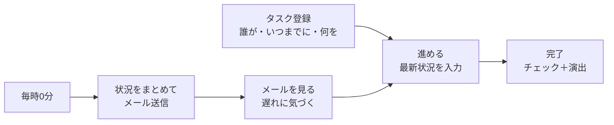
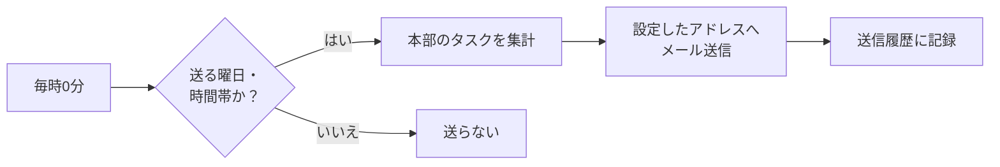

# 本部タスクリスト 要件定義書（たたき台 v0.1）

作成日: 2026-10-12 ／ 状態: **たたき台（確認待ち）**

> この資料は「何を作るか」を決めるためのものです。細かい見た目や作り方（プログラム）は、ここが固まってから決めます。
> 最後の [14. 確認したいこと](#14-確認したいこと) に答えてもらえたら v1.0 にします。

---

## 1. 目的

1. 本部の従業員のタスクを「**誰が・いつまでに・何を**」の形で必ず登録し、進み具合をみんなで見られるようにする
2. **1時間に1回**、本部のタスクの状況をメールで届け、「1時間に1回タスクを見る」流れをつくる
3. いつも使っている ToDo アプリと**同じ操作感**にして、新しく覚えることを増やさない

## 2. 前提（想定）

| 項目 | 想定 |
|---|---|
| お手本の ToDo アプリ | **Microsoft To Do**（「新しいリスト」があり、完了時に音やアニメーションが出るもの）※違うアプリならお手本を差し替える |
| 使う人 | 本部の従業員だけ。加盟店・事業所のスタッフは使わない |
| 使う端末 | パソコン（Chrome・Edge）とスマホ（iPhone・Android のブラウザ） |
| 言語・時間 | 日本語のみ／日本時間 |

## 3. 全体像

お手本アプリの機能はそのまま全部使えるようにして（4章）、そこにネコロボ独自の3つを足します。

| 独自機能 | ひとことで | 章 |
|---|---|---|
| 期限設定 | 「誰が・いつまでに・何を」を入れないと登録できない | 5章 |
| 進捗管理 | ステータスと「最新状況」の入力、本部全体の進捗ボード | 6章 |
| メール通知 | 毎時、設定したアドレスに本部のタスク状況を送る | 7章 |



---

## 4. お手本アプリから引き継ぐ機能（完全コピー）

- 機能・画面の並び・操作の流れは、お手本と同じにする
- ただし **Microsoft のロゴ・アイコン・効果音・背景写真などの素材と名前は使わない**（著作権・商標のため）。見た目が近いものを自作するか、フリー素材で用意する

ID の見方: **L** = リスト、**S** = スマートリスト、**T** = タスク、**E** = エフェクト、**C** = 設定

### 4.1 画面の構成（3列）

| 左: リスト一覧 | 中央: タスク一覧 | 右: タスクの詳細（開いたときだけ） |
|---|---|---|
| 自分の名前・検索<br/>スマートリスト（今日の予定・重要・計画済み・自分に割り当て・すべて・完了済み）<br/>進捗ボード（独自）<br/>――――<br/>自分たちで作ったリスト・グループ<br/>＋ 新しいリスト | リスト名・並べ替え・メニュー<br/>＋ タスクの追加（担当者・期限・繰り返しのボタン付き）<br/>未完了のタスク<br/>▼ 完了済み（たたんで表示） | タスク名・完了・重要<br/>ステップ<br/>今日の予定に追加<br/>担当者・期限・アラーム・繰り返し<br/>ステータス・最新状況（独自）<br/>カテゴリ・ファイル・詳細メモ<br/>作成日・削除 |

- スマホでは1列ずつ切り替えて表示する（リスト → タスク一覧 → 詳細）
- 左の列はたたむことができる

### 4.2 リスト

| ID | 機能 | 内容 |
|---|---|---|
| L01 | 新しいリスト | 名前を入れて作る。名前の先頭に絵文字を入れるとリストのアイコンになる |
| L02 | 名前の変更・削除 | 削除前に確認を出す（設定で切り替え） |
| L03 | リストの複製 | 中のタスクごとコピーする |
| L04 | グループ | 新しいグループを作り、リストをまとめる。名前変更・グループ解除 |
| L05 | 並べ替え | リスト・グループをドラッグで並べ替え |
| L06 | テーマ | リストごとに色や背景画像を選べる |
| L07 | タスクの並べ替え | 重要度・期限・今日の予定に追加済み・名前順・作成日（＋独自で担当者・ステータス）。昇順／降順の切り替え |
| L08 | 完了済みの表示 | 完了済みタスクを表示する／隠す |
| L09 | 印刷 | リストを印刷する |
| L10 | 公開範囲 | お手本の「リストの共有（招待リンク）」の代わり。本部全員に公開か、自分だけ（個人リスト）かを選ぶ（→ 8章） |

### 4.3 スマートリスト（自動でまとまるリスト）

| ID | リスト | 内容 |
|---|---|---|
| S01 | 今日の予定 | 自分が「今日やる」と決めたタスクを集める。**人ごと**に別。毎日0時に空になる（タスク自体は元のリストに残る）。「候補」ボタンで期限切れ・今日まで・最近追加したものを出す |
| S02 | 重要 | ★を付けたタスク |
| S03 | 計画済み | 期限のあるタスクを「期限切れ・今日・明日・今週・それ以降」に分けて表示 |
| S04 | 自分に割り当て | 担当者が自分のタスク |
| S05 | すべて | 見られる全タスク |
| S06 | 完了済み | 完了したタスク |
| S07 | タスク | 最初からある標準のリスト（どのリストにも入れなかったタスクの置き場） |

- 各スマートリストは設定で表示／非表示を選べる。空のスマートリストを自動で隠す設定も付ける

### 4.4 タスク

| ID | 機能 | 内容 |
|---|---|---|
| T01 | タスクの追加 | 一覧の上の入力欄に書いて Enter。入力欄の横に担当者・期限・繰り返しのボタン（→ 5章のルールで必須チェック） |
| T02 | 完了 | 丸いチェックを押すと完了。もう一度押すと未完了に戻る |
| T03 | 重要 | ★を押して付け外し |
| T04 | ステップ | タスクの中の小さなやること。追加・完了・並べ替え・削除・「タスクに昇格」 |
| T05 | 今日の予定に追加 | 付け外しできる（人ごと） |
| T06 | 期限 | 今日・明日・来週・日付を選ぶ（→ 5章で必須） |
| T07 | アラーム | 今日の後で・明日・来週・日時を選ぶ。その時刻に画面の通知を出す |
| T08 | 繰り返し | 毎日・平日・毎週・毎月・毎年・自分で決める（例: 2週間ごとの月・木）。完了すると次の回が新しい期限で自動でできる |
| T09 | カテゴリ | 色付きのラベルを付ける（複数可） |
| T10 | ファイル | ファイルを添付する（1件25MBまで） |
| T11 | メモ | 自由に書けるメモ（＝ 5章の「どのように」） |
| T12 | 移動・コピー | 別のリストへ移動／コピー。ドラッグでも移動できる |
| T13 | 並べ替え | ドラッグで並べ替え。今日の予定やリストにドラッグして追加 |
| T14 | 削除 | 削除前に確認を出す（設定で切り替え）。→ 6.6 のごみ箱 |
| T15 | 検索 | 全リストからタスク名・メモ・ステップを検索 |
| T16 | 作成情報 | 「○日前に作成（作成者）」を表示 |
| T17 | 右クリックメニュー | 今日の予定に追加・重要にする・完了にする・期限（今日／明日／日付を選ぶ）・移動先・コピー先・このタスクから新しいリストを作る・削除 |
| T18 | キーボード操作 | 例: 新しいタスク・新しいリスト・検索・完了・今日の予定に追加などをキー操作でできる（お手本と同じ組み合わせ） |

### 4.5 エフェクト（演出）

| ID | 演出 | 内容 |
|---|---|---|
| E01 | 完了のアニメーション | 丸がチェックに変わり、タスク名に線が引かれ、「完了済み」へすっと移る |
| E02 | 完了の音 | 完了したときに短い音が鳴る（設定でオフにできる） |
| E03 | 重要の★ | ★を付けたときに小さく動く |
| E04 | 今日の予定の背景 | 今日の予定の画面に、日替わりの背景画像と日付・あいさつを表示 |
| E05 | リストのテーマ | 選んだ色・背景画像がリスト全体に反映される |
| E06 | 操作の動き | ドラッグ中の影、詳細パネルの開閉、追加・削除のなめらかな動き |

### 4.6 設定（人ごと）

| ID | 設定 | 内容 |
|---|---|---|
| C01 | 削除前に確認する | オン／オフ |
| C02 | 新しいタスクを上に追加する | オン／オフ |
| C03 | ★付きタスクを上に移動する | オン／オフ |
| C04 | 完了の音を鳴らす | オン／オフ |
| C05 | 右クリックメニューを使う | オン／オフ |
| C06 | 今日の予定に、期限が今日・期限切れのタスクを出す | オン／オフ |
| C07 | テーマ | ライト／ダーク／端末に合わせる |
| C08 | スマートリスト | 各スマートリストの表示／非表示、空なら自動で隠す |
| C09 | 通知 | アラームの通知のオン／オフ |
| C10 | メールの受け取り | 自分も毎時メールを受け取るか（→ 7章。送信先の一覧は管理者が管理） |

### 4.7 引き継がないもの

- Outlook のフラグ付きメール、Planner、Microsoft アカウントなど Microsoft 365 との連携
- 招待リンクでのリスト共有（本部全員で使うアプリなので、L10 の公開範囲で代わりにする）

---

## 5. 期限設定（誰が・いつまでに・何を）

### 5.1 タスクの項目

| 項目 | 必須 | 中身 |
|---|---|---|
| **何を**（タスク名） | **必須** | やることを短く。例:「〇〇の書類を作成して送る」 |
| **誰が**（担当者） | **必須** | 本部の従業員から**1人**選ぶ。責任を持つ人を1人に決めるため |
| **いつまでに**（期限） | **必須** | 日付は必須、時刻は任意。時刻なしは「その日中（23:59）」として扱う |
| どのように（詳細） | 任意 | やり方・メモ（T11） |
| 協力者 | 任意 | 一緒に進める人（複数可）。協力者の「自分に割り当て」にも表示する |
| その他 | 任意 | ステップ・重要・カテゴリ・ファイル・繰り返し・アラーム（4章のとおり） |

### 5.2 ルール

1. **タスク名・担当者・期限の3つがそろうまで登録できない**。足りない項目を赤で示し、「担当者と期限を入れてください」と出す
2. 入力欄の担当者には、最初から「自分」が入っている（変えられる）。期限は空で、毎回選ぶ（今日・明日・今週金曜・来週・日付を選ぶ）
3. 「計画済み」「今日の予定」で追加するときは、期限に「今日」が最初から入る（見えるので、そのままでよいか確認できる）
4. 期限を過ぎた未完了タスクは**赤**で「○日超過」と表示する。今日までのものは目立つ色で表示する
5. 担当者・期限を変えたときは「誰が・いつ・何から何に」変えたかを残す
6. 期限を延ばすときは理由を書けるようにする（必須にするかは [確認事項](#14-確認したいこと)）
7. ステップにも担当者・期限を付けられる（任意）
8. 繰り返しタスクは、完了すると次の回が新しい期限・同じ担当者で自動でできる
9. 担当者が退職・異動したときは、管理者がその人のタスクをまとめて別の人に付け替えられる

---

## 6. 進捗管理

### 6.1 ステータス

| ステータス | 意味 | 変わり方 |
|---|---|---|
| 未着手 | まだ手を付けていない | 登録したとき |
| 進行中 | やっている | 自分で切り替える。最新状況を書くと自動で「進行中」になる |
| 完了 | 終わった | 丸いチェックを押す（E01・E02 の演出つき）。完了した人・日時を残す |

- 「保留（相手の返事待ちなど）」を足すかは [確認事項](#14-確認したいこと)
- 完了したときに、期限内か遅れて完了したかも記録する

### 6.2 最新状況の入力

指定申請アプリの「最新情報の入力」と同じ考え方にする。

- タスクの詳細に「最新状況」欄を置く。書いて保存すると**日時・書いた人つきで履歴に積み上がる**（上書きしない）
- 一覧・進捗ボード・メールには**一番新しい1件**を表示する
- 最後に更新してから一定の日数（例: 3日）たった未完了タスクには「更新が止まっています」と表示する
- 指定申請アプリの入力画面と同じ並び・操作にそろえる（画面を見せてもらって合わせる）

### 6.3 進捗率（任意）

- ステップがあるタスクは「2/5」のように、完了したステップの数を表示する

### 6.4 進捗ボード（ネコロボ独自のスマートリスト）

本部全体の状況を1画面で見るためのもの。毎時メールと同じ中身を画面で見られる。

| 表示 | 中身 |
|---|---|
| まとめ | 未完了の数、うち期限切れ・今日まで・3日以内の数 |
| 担当者別の表 | 担当者ごとに 期限切れ／今日まで／今週まで／進行中／未着手／今週完了 の件数。数字を押すとそのタスク一覧へ |
| 期限切れの一覧 | 超過日数の多い順。担当者・期限・最新状況つき |
| 更新が止まっているタスク | 6.2 の「更新が止まっています」のもの |
| 絞り込み | 担当者・リスト・ステータス・期限・カテゴリ |

### 6.5 変更の記録

- タスクの作成・変更・完了・削除を「誰が・いつ・何を」変えたか記録し、タスクの詳細から見られるようにする

### 6.6 ごみ箱（お手本との違い）

- お手本は削除するとすぐ消えるが、本部の管理のため**ごみ箱に30日残し**、管理者が元に戻せるようにする

### 6.7 画面の自動更新

- 他の人が登録・変更した内容は、画面を開いたままでも数秒以内に反映する

---

## 7. メール通知（1時間に1回）

### 7.1 しくみ



### 7.2 管理者が設定する項目

| 項目 | 内容 | 最初の値（案） |
|---|---|---|
| 送信のオン／オフ | メール通知全体を止められる | オン |
| 送信先 | メールアドレスを複数登録できる。追加・削除・一時停止 | − |
| 送る曜日 | 曜日を選ぶ | 月〜金 |
| 祝日 | 祝日は送らない | 送らない |
| 送る時間帯 | 何時から何時まで、毎時0分に送るか | 9時〜18時（1日10通） |
| 変化がないときも送る | この1時間で何も動きがなくても送るか | 送る（毎時見る習慣のため） |
| 載せる中身 | 下の 7.3 の各ブロックを載せる／載せない | 全部載せる |
| 「近い期限」の日数 | 何日先までを「近い期限」にするか | 3日 |
| テスト送信 | 今の設定でいますぐ1通送ってみる | − |
| 送信履歴 | 送った日時・宛先の数・成功／失敗 | − |

### 7.3 メールの中身（見本・架空のデータ）

```text
件名: 【本部タスク】10/13(月) 14:00時点　期限切れ2件・今日まで3件

本部タスクの状況（10/13 14:00 時点）

■ まとめ
未完了 24件（期限切れ 2件／今日まで 3件／3日以内 5件）
この1時間の動き: 新規 2件・完了 4件・最新状況の更新 3件

■ 期限切れ（2件）
・[2日超過] 研修資料を作成する　担当: Aさん　期限: 10/11
　最新状況（10/12 16:30）: 下書きまで完了。明日の午前に仕上げる
・[1日超過] 備品の発注先を決める　担当: Bさん　期限: 10/12
　最新状況: まだ入力がありません

■ 今日まで（3件）
・会議の議事録を共有する　担当: Cさん　期限: 10/13 17:00　進行中
・…

■ 3日以内（5件）
・…

■ この1時間で完了（4件）
・…

■ 担当者別
担当　　期限切れ　今日まで　進行中　未着手
Aさん　　1　　　　1　　　　2　　　3
Bさん　　1　　　　0　　　　1　　　4
…

▶ アプリで開く: （アプリのURL）
```

- 各タスク名を押すと、アプリのそのタスクが開く
- パソコン・スマホのどちらでも読みやすい形にする（文字だけのメールにも対応）

### 7.4 ルール

1. 毎時0分から**5分以内**に届く
2. 送れなかったときは、次の回にまとめて送り直し、管理画面に「送信失敗」を表示する
3. 個人リスト（自分だけのリスト）のタスクはメールに載せない
4. 送信元は**システム専用のアドレス**（例: `noreply@【システム用ドメイン】`）。会社の普段のメールとは分ける（迷惑メール判定の影響を分けるため）
5. メールは社外のサーバーを通るので、**タスク名・最新状況に利用者さんの名前などの個人情報を書かない**ルールにし、入力欄に注意書きを出す

### 7.5 あとで足せるもの（今回は作らない）

- 担当者ごとに「自分の分だけ」の個別メール
- Chatwork への通知
- 期限の前日・当日の朝に担当者へお知らせ

---

## 8. 使う人と権限

| 役割 | できること |
|---|---|
| 管理者 | 全部。メール通知の設定、メンバーの追加・停止、担当者の一括付け替え、ごみ箱から戻す |
| 本部メンバー | タスク・リストの登録・変更・完了、最新状況の入力、進捗ボードを見る、自分の設定 |

- 本部メンバーは**本部全員のタスクを見られる**（進み具合をみんなで見るため）。誰でも最新状況を書ける
- 自分だけが見る「個人リスト」も作れる（L10）。個人リストは進捗ボードとメールに出ない
- 退職した人はアカウントを止める（タスクと履歴は残す）

## 9. 画面一覧

| No | 画面 | 中身 |
|---|---|---|
| 1 | ログイン | 会社のアカウントでログイン |
| 2 | メイン画面 | 4.1 の3列の画面（リスト・タスク一覧・詳細） |
| 3 | 進捗ボード | 6.4 |
| 4 | 検索結果 | T15 |
| 5 | 設定（人ごと） | 4.6 |
| 6 | 管理: メール通知 | 7.2 の設定・テスト送信・送信履歴 |
| 7 | 管理: メンバー | 本部メンバーの追加・停止・役割・担当の付け替え |
| 8 | 管理: ごみ箱 | 6.6 |

## 10. データ項目

### 10.1 タスク

| 項目 | 必須 | 備考 |
|---|---|---|
| タスク名 | ○ | |
| 担当者 | ○ | 1人 |
| 期限（日付） | ○ | |
| 期限（時刻） | | なければ 23:59 扱い |
| 詳細メモ | | |
| リスト | ○ | 最初は「タスク」 |
| ステータス | ○ | 未着手／進行中／完了 |
| 協力者 | | 複数 |
| 重要 | | ★ |
| ステップ | | 名前・完了・並び順（＋任意で担当者・期限） |
| 繰り返し | | |
| アラーム | | 人ごと |
| 今日の予定 | | 人ごと・日付つき |
| カテゴリ | | 複数 |
| 添付ファイル | | |
| 並び順 | | |
| 作成者・作成日時 | 自動 | |
| 更新者・更新日時 | 自動 | |
| 完了者・完了日時・期限内か | 自動 | |
| 削除日時 | 自動 | ごみ箱用 |

### 10.2 その他

| データ | 主な項目 |
|---|---|
| リスト | 名前・アイコン・テーマ・グループ・公開範囲・並び順・並べ替え方・完了済みの表示 |
| グループ | 名前・並び順 |
| 最新状況 | タスク・本文・書いた人・日時 |
| 変更の記録 | タスク・変えた人・日時・項目・変更前・変更後・（期限延長の理由） |
| メンバー | 名前・メールアドレス・役割・在籍／停止 |
| 個人設定 | 4.6 の各項目 |
| メール通知設定 | 7.2 の各項目・送信先の一覧 |
| 送信履歴 | 日時・宛先の数・成功／失敗・失敗の理由 |

## 11. 使いやすさ・安全などの条件（非機能要件）

| 項目 | 条件 |
|---|---|
| 速さ | チェック・★・追加などは押した瞬間に画面に反映する（保存は裏で行う）。画面の表示は2秒以内 |
| 同時に使う人数 | 本部全員が同時に開いても問題なく動く |
| 端末 | パソコン（Chrome・Edge の最新版）、スマホ（iPhone の Safari・Android の Chrome）。スマホのホーム画面に追加してアプリのように使える |
| ログイン | 会社のアカウントだけがログインできる。一定時間操作がなければ自動でログアウト |
| 守り | 通信は暗号化（https）。権限のない人はデータを見られないように、データベース側でも制限する |
| 記録 | 6.5 の変更の記録、7.2 の送信履歴を残す |
| バックアップ | 毎日自動でバックアップ。完了・削除したタスクも履歴として残す |
| 個人情報 | 利用者さんの個人情報は入れない運用。テスト用データは架空のものだけ使う |

## 12. 作り方の案

| 案 | 中身 | 良いところ | 気になるところ |
|---|---|---|---|
| **A. 社内管理システムに入れる（おすすめ）** | いま設計中の本部用・加盟店用の管理システム（nekoroboapp）の**本部用画面**に、1つのアプリとして入れる | ログイン・従業員の情報・メール送信の仕組みを共通で使える。あとで「期限管理」「通知センター」とつなげやすい | 共通の土台（ログインなど）ができるのを待つ部分がある |
| B. 単体で作る（A と同じ道具） | A と同じ道具で、このアプリだけ先に作る | すぐ始められる | ログインや従業員の情報を二重に持つことになる。あとで A に引っ越す手間 |
| C. GAS ＋ スプレッドシート | Google の仕組みで簡単に作る | 一番早く・安く作れる | お手本どおりの操作感（ドラッグ・演出・同時編集）は再現しにくい。メールの送信数に上限がある（無料の Google アカウントは1日100通まで） |

A・B で使う道具（社内管理システムの設計に合わせる）:
- 画面: Next.js（Web アプリを作る道具）
- データ・ログイン: Supabase（データベースのサービス、東京）
- 公開: Vercel
- 毎時の処理: Supabase の定期実行
- メール: Resend などのメール配信サービス

## 13. 進める順番

お手本の機能は全部作る前提で、順番だけ分けます。

| 段階 | 作るもの |
|---|---|
| 1. 土台 | ログイン、メンバー、メイン画面の3列、リスト（L01〜L08・L10）、タスクの基本（T01〜T06・T11〜T17）、**期限設定（5章）**、スマートリスト |
| 2. 進捗とメール | **進捗管理（6章）**、**毎時メール（7章）**、管理画面 |
| 3. お手本の残り | エフェクト・テーマ（4.5）、繰り返し・アラーム・カテゴリ・ファイル、印刷、キーボード操作、設定の全項目 |
| 4. 確認・公開 | 本部の数人で試す → 直す → 全員で使い始める |

※ 「毎時メールを早く使い始めたい」なら、段階2を段階1のすぐ後に回せる

---

## 14. 確認したいこと

| No | 確認したいこと | おすすめ |
|---|---|---|
| 1 | お手本の ToDo アプリは **Microsoft To Do** で合っていますか？ | Microsoft To Do の前提で書いています |
| 2 | どこに作りますか？（12章） | **A. 社内管理システムの本部用画面に入れる** |
| 3 | 使う本部の従業員は何人くらいですか？ | − |
| 4 | 本部全員が、全員のタスクを見られてよいですか？ | **見られる**（個人リストだけ自分専用） |
| 5 | 担当者は1人に決めてよいですか？ | **1人＋協力者（複数）** |
| 6 | ステータスに「保留」は要りますか？ | まずは **未着手・進行中・完了** の3つ |
| 7 | メールを送る曜日・時間帯は？ | **平日9時〜18時の毎時（1日10通）** |
| 8 | この1時間で動きがなくてもメールを送りますか？ | **送る** |
| 9 | メールの送信先は、決まったアドレス（例: 本部の共有アドレス）ですか？ 本部の全員ですか？ | − |
| 10 | 期限を延ばすときの理由は必須にしますか？ | **任意**（書く欄は出す） |
| 11 | 指定申請アプリの「最新情報の入力」の画面を見せてもらえますか？（スクショ。個人情報は隠してOK） | 同じ操作感にそろえるため |
| 12 | タスクに「関係する事業所」を付けたいですか？（例: 立ち上げ中の事業所の作業） | あとから足せるので、必要なら |

## 15. 用語

| 用語 | 意味 |
|---|---|
| リスト | タスクを入れる箱。「研修」「出店」など自由に作る |
| スマートリスト | 条件で自動的にタスクが集まるリスト（今日の予定・重要 など） |
| ステップ | タスクの中の小さなやること |
| 最新状況 | タスクの今の進み具合を書く欄。履歴として積み上がる |
| 進捗ボード | 本部全体の進み具合を1画面で見る、このアプリ独自の画面 |
