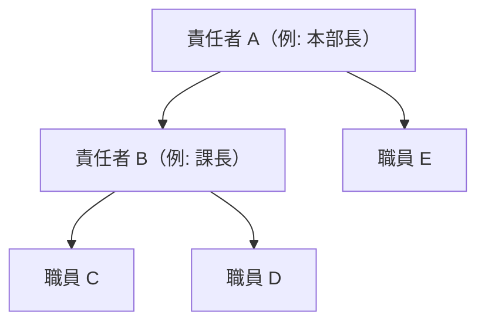

# 責任者と職員・進捗確認メール・通知 要件定義書（たたき台 v0.1）

作成日: 2026-10-14 ／ 状態: **たたき台（決めてほしいことは 8章）**

本部の中を「責任者」と「職員」に分け、責任者が職員に**進捗確認のメール**を設定し、**通知**を送れるようにする。

---

## 1. 目的

- 責任者が、自分のチームの職員のタスクの進み具合を、聞きに行かなくても分かるようにする
- 職員が「今日やること」「期限切れ」「進捗を書いてほしいもの」を、毎日自分宛てに受け取れるようにする
- 声かけ（「あの件どうなってる？」）を、記録に残る形にする

## 2. 役割（構造）

| 役割 | だれ | ひとことで |
|---|---|---|
| **責任者** | 部門・チームのまとめ役 | チームの職員にタスクを頼む・進捗を確認する・メールと通知を設定する |
| **職員** | それ以外の本部の人 | 自分のタスクを進め、最新状況を書く |

- 職員1人ごとに「担当の責任者」を1人決める（＝チーム）。責任者の上にさらに責任者がいてもよい（例: 部長 → 課長 → 職員）
- 1人が「責任者」かつ「ほかの責任者のチームの職員」になれる
- 設定は 設定 →「メンバー」で、役割と担当の責任者を選ぶ（変えられるのは責任者だけ）
- 全権限のアカウント（本部の管理用「ネコロボマン本部」）は、責任者を含むすべての役割の操作ができる（[accounts.md](accounts.md)）

## 3. できること（役割ごと）

記号: ◎ できる ／ ○ 自分・自分のチームの分だけ ／ − できない

| 機能 | 責任者 | 職員 |
|---|---|---|
| タスクを見る | ◎ 全員 | ◎ 全員（今のまま。8章で決める） |
| タスクを作る・自分に割り当てる | ◎ | ◎ |
| ほかの人にタスクを頼む | ◎ | ◎（今のまま。8章で決める） |
| チームの進捗ボード（自分のチームだけに絞った表） | ○ | − |
| **進捗確認メールの設定**（4章） | ○ 自分のチームの職員に | − （自分宛ての受け取り方だけ変えられる） |
| **通知を送る**（5章） | ○ 自分のチームの職員に | − |
| 全体の毎時メールの設定 | ◎ | − |
| メンバーの追加・役割・担当の責任者の設定 | ◎ | − |

## 4. 進捗確認メール（責任者が設定 → 職員に届く）

責任者が「いつ・だれに・何を」送るかを決める。中身はその職員本人のタスクだけ。

| 項目 | 内容 | 最初の値（案） |
|---|---|---|
| 送り先 | 自分のチームの職員（全員／選んだ人） | チーム全員 |
| 送る日・時刻 | 曜日と時刻（複数可） | 平日 9:00（朝の確認）・金曜 16:00（週の確認） |
| 中身 | 期限切れ／今日まで／今日やる予定／今週まで／**最新状況が○日書かれていないもの**／責任者からのひとこと | 全部オン、○日＝3日 |
| 進捗の記入を頼む | 「このタスクの最新状況を○時までに書いてください」を付ける | 金曜 16:00 の回だけオン |
| 責任者にも写しを送る | 職員ごとのまとめを1通にして責任者に送る | オン |
| 休みの日 | 祝日・年末年始は送らない（毎時メールと同じ） | 送らない |

- メール内のタスク名を押すと、アプリでそのタスクが開き、すぐ最新状況を書ける
- 職員が「最新状況」を書いたら、担当の責任者に通知が届く（5章）
- 職員のメールアドレスは、設定 →「メンバー」で登録する（ない人には送らない。画面の通知だけ）

## 5. 通知（アプリの中のお知らせ＋メール）

### 5.1 責任者が送る通知

| 送り方 | 例 | 届き方 |
|---|---|---|
| **タスクから「進捗を確認」** | タスクの詳細 →「進捗を確認」→ ひとこと（任意）→ 送る | 担当の職員に通知＋メール。「○○さんから進捗の確認が届きました」 |
| **職員にまとめて** | メンバーの画面 →「通知を送る」→ 宛先（1人／チーム）・本文・関係するタスク（任意） | 選んだ職員に通知＋メール |
| 期限を決めた確認 | 「明日10時までに最新状況を書いてください」 | 期限までに書かれなければ、責任者に「まだ書かれていません」と通知 |

### 5.2 自動で届く通知

| きっかけ | 届く人 |
|---|---|
| タスクを頼まれた（担当になった） | 担当の職員 |
| 頼んだタスクが完了した・最新状況が書かれた | 頼んだ人・担当の責任者 |
| 担当のタスクが期限切れになった | 担当の職員と担当の責任者 |
| 予定に招待された・出欠が返ってきた（カレンダー） | 招待された人・主催者 |

### 5.3 通知の見え方

- 画面右上に**ベルのマーク**。読んでいない数を出す。押すと一覧（新しい順・既読／未読）
- 通知を押すと、そのタスク・予定が開く
- メールでも受け取るかは、通知の種類ごとに本人が選べる（責任者からの通知は必ずメールでも届く）

## 6. データ（追加・変更するもの）

| 表 | 追加・変更 |
|---|---|
| members | `role`（責任者／職員）、`manager_id`（担当の責任者） |
| notifications（新規） | だれに・だれから・種類・本文・関係するタスク／予定・既読・作成日時 |
| progress_mails（新規） | 責任者ごとの進捗確認メールの設定（宛先・曜日と時刻・中身・ひとこと） |
| mail_queue（新規） | これから送るメール（1人ずつのメールが増えるため、順番に送る） |

- 変更の記録（だれが・いつ・何を）は、今と同じくデータベースが自動で書く

## 7. 今のしくみとの関係・気をつけること

1. **共有アカウントのままでは、役割を本当には守れない**: 共有のアカウントでは端末ごとに「操作する人」を選ぶので、職員が責任者の名前を選べてしまう。招待制の一人ずつのアカウント（[accounts.md](accounts.md)）を使えば守れる
2. **メールの数**: 1人ずつにメールを送るので、Gmail の1日100通の上限に近づく（例: 職員20人×1日2通＝40通＋毎時メール）。人数が増えたら、会社ドメインのメール配信（Resend）に切り替える
3. **メール送信用 GAS の貼り替えが1回必要**: 1分に複数通送れるようにするため
4. nekoroboapp（W14）に引っ越すときは、役割は全体の権限（本部のロール）に、通知は全体の通知のしくみに合わせる

## 8. 決めてほしいこと

| No | 決めること | 選択肢 | おすすめ |
|---|---|---|---|
| 1 | 構造の作り方 | ア. 職員ごとに担当の責任者を1人 ／ イ. 部署（チーム）を作り、部署に責任者を置く | **ア**（シンプル。部署名は後から足せる） |
| 2 | 職員が見られる範囲 | ア. 全員のタスク（今のまま） ／ イ. 自分とチームだけ | **ア**（本部は少人数で、ほかの人の状況も見えた方が助け合える） |
| 3 | 責任者の操作の守り | ~~ア. 責任者ごとに暗証番号~~ ／ イ. 一人ずつのログイン | **イ**（2026-10-14 に招待制の一人ずつのログインを入れたため、これで守れる。[accounts.md](accounts.md)） |
| 4 | 職員がほかの人にタスクを頼めるか | ア. できる（今のまま） ／ イ. 責任者だけ | **ア** |
| 5 | 進捗確認メールの最初の時刻 | 平日 9:00 ＋ 金曜 16:00 でよいか | **はい** |
| 6 | 責任者と職員の最初の割り当て | だれが責任者か（名前で教えてもらえれば設定する） | − |
